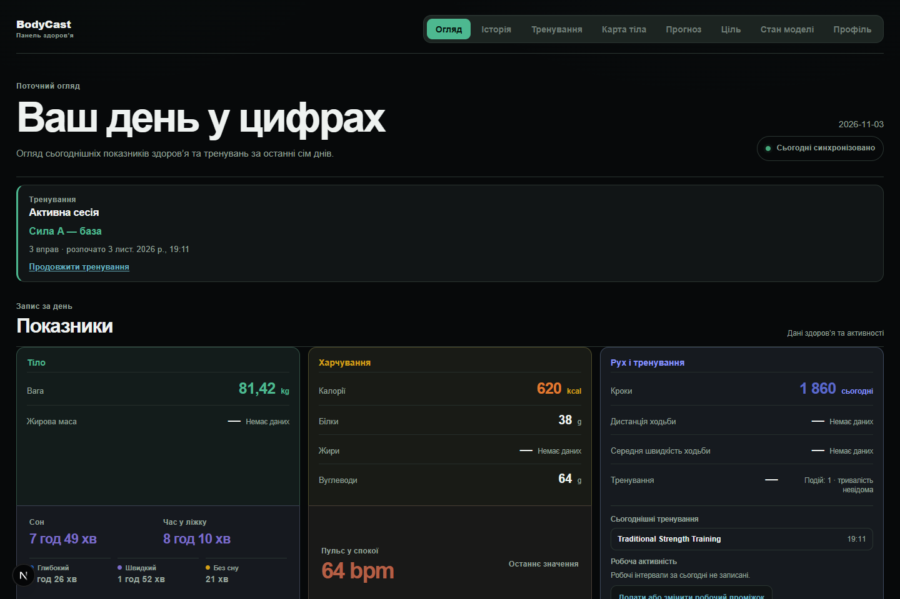
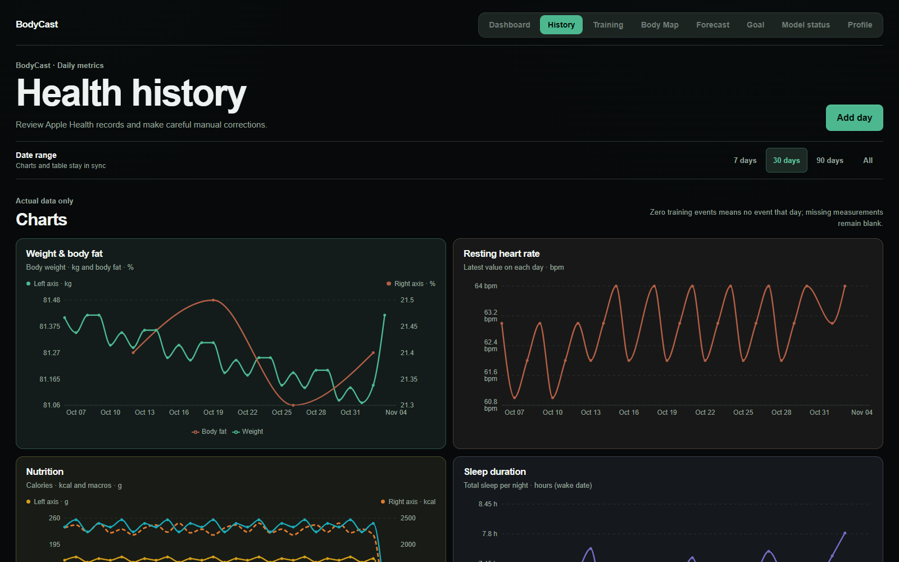
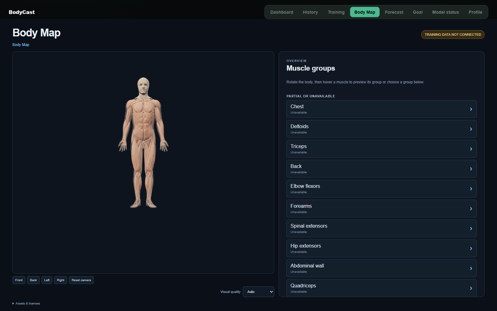
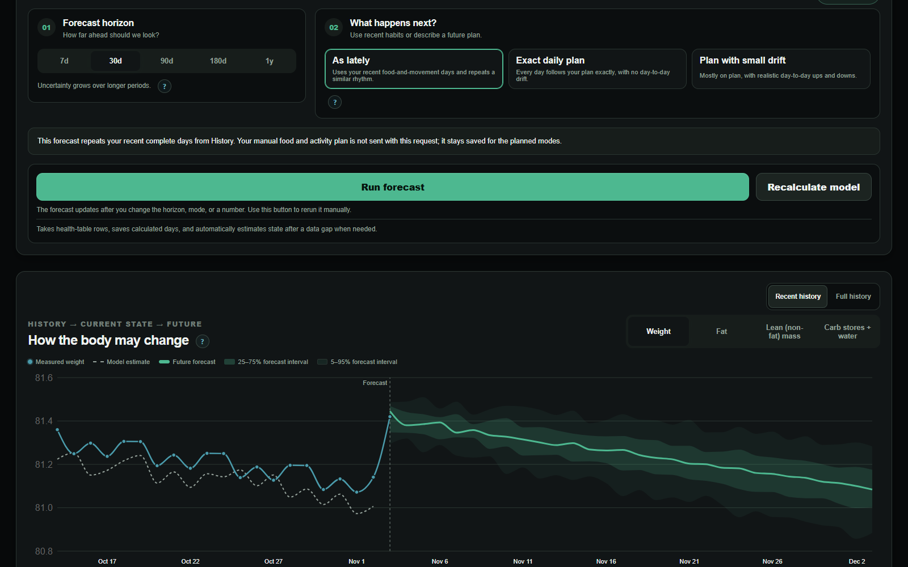
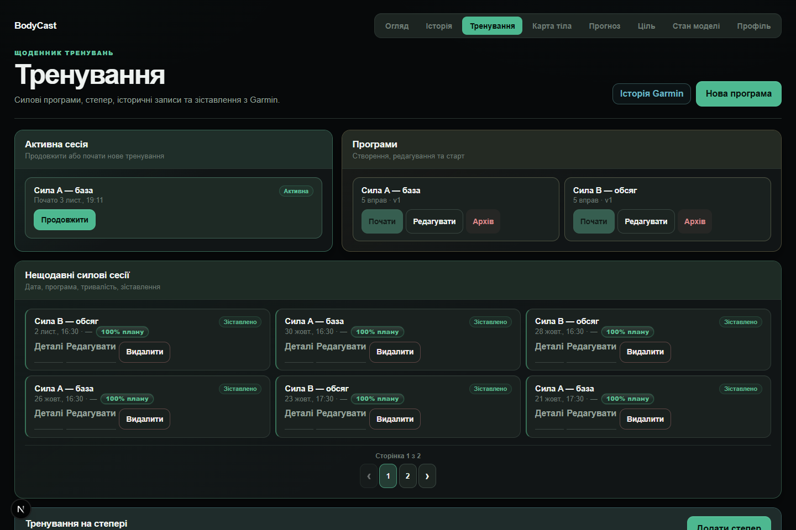
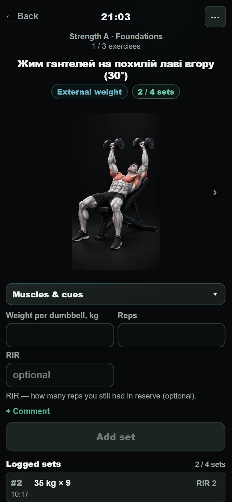
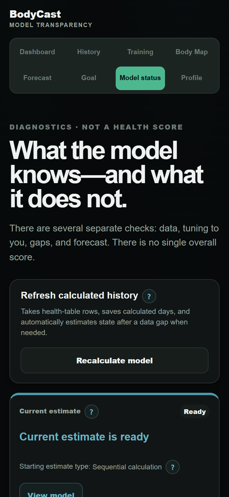
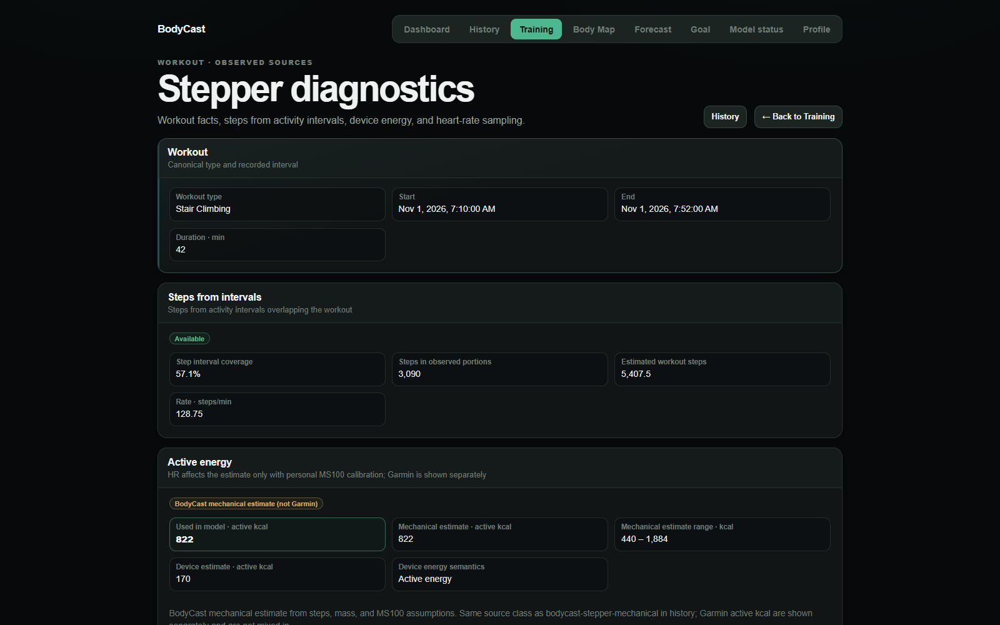

# BodyCast

BodyCast is a personal health and training analytics application. It brings daily health measurements, workout history, strength training, and model-based body-composition estimates into one inspectable timeline.

The project emphasizes source provenance and data quality: missing measurements remain unknown, workout energy shows where an estimate came from, and model outputs expose freshness and coverage instead of presenting one unexplained score.

> BodyCast provides estimates and planning scenarios, not medical advice or guaranteed outcomes.

## Screenshots

All screenshots use the English UI and synthetic data created in an isolated local PostgreSQL database. They do not show a user's production records. Exercise names retain their stored language. Desktop captures use a 1600px-wide viewport; phone captures use a 390px-wide mobile viewport. The Body Map preview displays the 3D anatomy view; training exposure is not connected in this fixture.

### Desktop

| Daily overview | Health history |
| --- | --- |
|  |  |

| 3D Body Map | Forecast and uncertainty |
| --- | --- |
|  |  |

### Phone

| Training diary | Active strength session |
| --- | --- |
|  |  |

| Model diagnostics | Stepper energy diagnostics |
| --- | --- |
|  |  |

## What it does

- **Health history:** stores daily measurements and timestamped health samples, with charts for weight, nutrition, heart rate, sleep, and activity.
- **Health sync:** accepts Apple Shortcut payloads through a validated API and retains point-level timestamps where supplied.
- **Training diary:** manages strength programs, sessions, exercises, sets, retrospective workout matching, and Stepper activity.
- **Active Energy:** resolves workout energy from available device and BodyCast evidence while retaining source and provenance information.
- **Model transparency:** shows input coverage, gaps, model status, and the distinction between observed values and derived estimates.
- **Forecast and goal planning:** explores scenario-based weight trajectories and target feasibility when the required current model state is available.
- **Body Map:** provides an interactive 3D anatomy view for mapped exercise exposure when exercise-to-muscle data are available.
- **Profile and access:** supports email-verified accounts, profile-scoped API keys, and profile-scoped application data.

Forecast and goal outputs depend on the freshness and availability of upstream model state. The forecast screenshot shows an application-generated result based on the synthetic local preview data.

## Technology

| Area | Technologies |
| --- | --- |
| Web application | Next.js 16 App Router, React 19, TypeScript 5, CSS Modules |
| Data and persistence | PostgreSQL 17, Prisma 6 |
| Authentication | Better Auth 1.7 with email OTP and profile-scoped API keys |
| Validation and charts | Zod 4, Recharts 3 |
| Local infrastructure | Docker Compose |
| Quality checks | ESLint 9, TypeScript, Vitest 3, Playwright 1, GitHub Actions |

Pinned versions are defined by `package.json`, `package-lock.json`, `.nvmrc`, and the Dockerfiles.

## Architecture

The application uses the Next.js App Router for pages and HTTP endpoints. Route handlers validate requests, resolve a session or API-key principal, and delegate work to feature services and repositories. Prisma persists source records and versioned derived results in PostgreSQL.

Health and training changes invalidate affected calculations and enqueue durable refresh work. Model and energy publication uses source fingerprints, generations, and currentness fences so readers can distinguish current results from stale or unavailable outputs. The complete component diagram and data-layer notes are in [the architecture overview](docs/architecture/project-overview.md).

## Getting started

### Requirements

- Node.js 24 (the version pinned by `.nvmrc` and Docker)
- npm
- Docker Engine with Docker Compose v2 for the containerized development stack

Install dependencies and copy the safe example environment:

```bash
npm ci
cp .env.example .env
```

Set local-only values in `.env`. Never use a production `DATABASE_URL`, API key, Auth secret, or mail-provider credential for local development.

### Database setup caveat

The latest Auth migration requires an existing legacy Profile 1 row. Consequently, applying the complete migration tree to a brand-new empty database is not a supported one-command setup: `docker compose up --build` can stop at `20261027120000_auth_multiuser` unless the local database has first been prepared with the legacy baseline and a synthetic Profile 1. The PostgreSQL integration job in [CI](.github/workflows/ci.yml) documents that preparation order. Do not work around this by pointing local commands at production.

The repository's seeded full-site preview is described in [the local QA guide](docs/qa/fullsite-preview.md). The seed refuses any database other than `bodycast_qa` at `127.0.0.1:55434` with the expected QA database role, then populates synthetic records and rebuilds model outputs through application services.

Once a local database has been prepared, the supported development container command is:

```bash
docker compose up --build
```

The development app is available at <http://localhost:3000>. Its Compose startup runs Prisma client generation and `prisma migrate deploy` against the local Compose database. Integration tests require a dedicated isolated PostgreSQL database; follow the CI workflow rather than reusing a production or personal database.

## Apple Shortcut sync API

Create a profile-scoped key while signed in under **Profile → Personal API keys**. The secret is shown only once. Send the complete key in the `X-API-Key` header; do not use a key ID or a `Bearer` prefix.

```bash
curl -X POST http://localhost:3000/api/v1/health/sync \
  -H "Content-Type: application/json" \
  -H "X-API-Key: YOUR_PERSONAL_API_KEY" \
  -d '{
    "days": [{
      "Date": "2026-08-22",
      "Weightkg": "89.15",
      "Steps": "23"
    }]
  }'
```

The sync API also accepts the newer range format with timestamped series such as `caloriesKcal`, `proteinG`, `fatG`, `carbsG`, `weightKg`, `bodyFatPercent`, and `averageWalkingSpeedKmh`. The server validates timestamps and series lengths, normalizes the payload, and retains individual observations for later analysis. See the health sync route schemas for the current request contract.

The range format can represent up to three calendar days. Calories and macros require one value per day; weight and body-fat use the last value recorded that day; walking speed is averaged. The server derives strength-training minutes from the latest workout's start and end times and leaves the value unknown when that workout started on another date. In legacy daily fields, `0` means no recorded value and is stored/read as `null`; repeated syncs update the daily record for that date.

## Testing and validation

Useful local commands:

```bash
npm run prisma:generate
npm run lint
npm run typecheck
npm run test:unit
npm run test:coverage
```

PostgreSQL integration tests require the isolated database identity and migration preconditions configured in [`.github/workflows/ci.yml`](.github/workflows/ci.yml). `npm run test:integration` must not be pointed at production. The full CI workflow also runs model smoke validations and a production build.

## Repository map

| Path | Responsibility |
| --- | --- |
| `src/app/` | App Router pages, route handlers, and page-level UI |
| `src/modules/health/` | Health sync, source normalization, retention, and workout feed handling |
| `src/modules/training/` | Strength diary, Stepper, workout matching, load accounting, and training refresh |
| `src/modules/model-episodes/` | Model episodes, persisted physiology state, and publication lifecycle |
| `src/modules/activity/` | Active Energy materialization, invalidation, and canonical publication |
| `src/modules/model-forecast/`, `model-goal-planning/` | Forecast and goal scenario calculations |
| `prisma/` | PostgreSQL schema and migration history |
| `tests/` | Unit and PostgreSQL integration coverage |
| `scripts/qa/` | Guarded local-only preview setup and screenshot tooling |
| `docs/` | Architecture, QA, research, and operational runbooks |

## Project status and operational notes

This repository contains a feature-rich personal application and active experimental model work. A route existing in the UI does not guarantee that every derived result is currently publishable; source coverage, model generation, and freshness gates remain visible parts of the product.

Production operations are separate from local development. Deployment and migration procedures are documented in [`docs/development/production-deploy.md`](docs/development/production-deploy.md), [`docs/development/production-migration-v5-runbook.md`](docs/development/production-migration-v5-runbook.md), and the related recovery runbooks. Ordinary application release and production schema change are distinct workflows; production migrations require their own authorization. This README does not claim that production was verified as part of the portfolio work.

No license file is present in this checkout. Add an appropriate license before inviting external contributions or granting redistribution rights.

## Possible next improvements

- Add a single, disposable local database bootstrap that prepares the legacy Profile 1 prerequisite before the current Auth migrations.
- Provide a local-only email capture method for OTP-based preview accounts without using production email credentials.
- Update the full-site screenshot helper to attach an authenticated local session to its API preflight requests.
- Make the seeded local preview publish a forecast-ready current model state, or label the forecast section as unavailable in that fixture.
