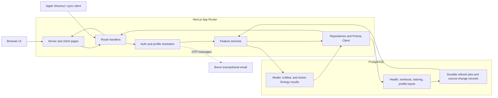
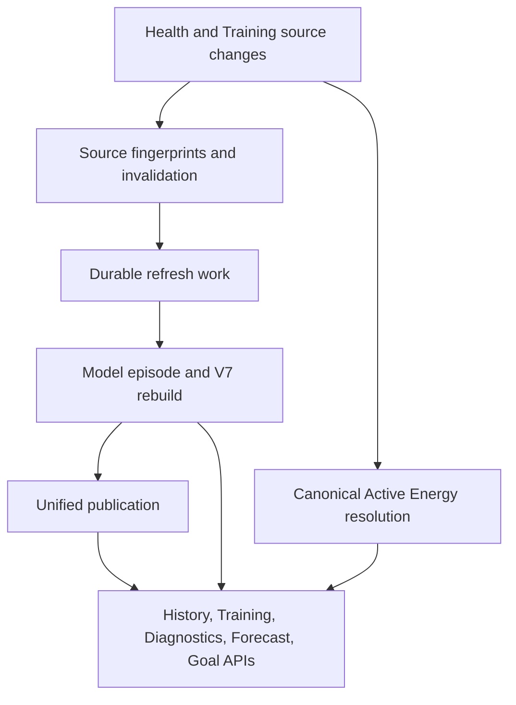

# BodyCast project overview

This note describes the architecture visible in the current repository. It is an implementation overview, not a production topology guarantee.

## Request and data flow

### Main boundaries

- **UI and HTTP:** `src/app/` contains pages and route handlers. The UI calls the same application APIs used by sync clients where their contracts overlap.
- **Identity and scope:** Auth resolves a verified session or a profile-scoped API key to a Profile principal. Feature routes then pass the resolved profile scope into services and repositories.
- **Feature modules:** `src/modules/` separates health ingestion, training, active energy, model calculations, forecasts, goal planning, diagnostics, and profile behavior.
- **Persistence:** Prisma maps PostgreSQL records. Source records, durable work queues, and versioned calculated outputs have separate roles in the schema.
- **Email:** Better Auth OTP messages are sent through the configured transactional email provider. Provider configuration is independent from local database setup.

## Source data and calculated state

The system distinguishes durable user/source observations from outputs that can be rebuilt:

| Layer | Examples | Purpose |
| --- | --- | --- |
| Source observations | Daily health values, timestamped health samples, sync snapshots, workouts, work intervals, training sessions, exercises, sets, and profile inputs | User history and external observations that calculations consume |
| Durable coordination | Health and Training refresh jobs, source-change records, publication blocks, generation markers | Track required work and prevent stale results from appearing current |
| Derived state | Model episode results, persisted Physiology V7 days, Unified state, Active Energy candidates/resolutions, diagnostics, forecast outputs | Calculations and explanations built from source data |

The boundary is deliberate: a missing observation is not silently converted to zero, and a calculated output does not replace its recorded source or provenance. Invalidation and publication generations tie derived data to the inputs and calculation version that produced it.

Specific invalidation rules and persistence contracts are documented in [Physiology V7 persistence](physiology-v7-persistence.md), the [Unified V4 rollout](unified-glycogen-v4-rollout.md), and the [Auth and multi-user plan](auth-multi-user-plan.md).

## Local and production boundaries

- Local development and QA use isolated PostgreSQL databases and synthetic records. The full-site QA seed has a strict database name, host, port, role, and mode guard before it clears its disposable fixture.
- GitHub Actions CI uses isolated PostgreSQL service containers and does not use production credentials.
- Production deployment, schema changes, historical recalculation, and model activation are separate operational workflows. Follow the relevant runbook and authorization gates; do not infer production status from a local preview or CI result.

## Current limitations relevant to evaluation

- A fresh local database needs the legacy Profile 1 migration precondition before the Auth migrations; the PostgreSQL integration CI job documents the ordering.
- The seeded full-site preview creates a complete historical model-episode/V7 fixture, but it does not currently publish the Unified model state needed for a forecast calculation. Forecast and Goal routes therefore report `initial-state-unavailable` in this local fixture.
- The checked-in screenshot helper performs initial API requests without forwarding an authenticated session cookie. Screenshots in the README were captured with a temporary local session against the isolated synthetic database; the helper still needs an Auth-aware preflight before it is a reproducible one-command capture flow.
